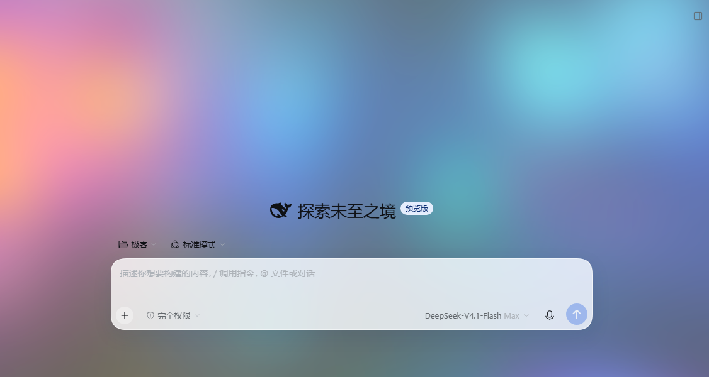

# dsh-frosted-glass-theme · 磨砂玻璃主题

[中文](#) | 简体中文

DeepSeek Harness Web UI 的**磨砂玻璃主题**：半透明的白色毛玻璃面板，浮在一层柔和彩色玻璃底图上（真·透桌面模式下直接透出你的桌面壁纸）；浅色 / 深色两套，跟随 DSH 自带的配色切换。**对话页、轨迹页、统计页共用同一套透色**，不再出现「轨迹页发白」的分裂观感。



## 它做什么

- **一整层玻璃底图**：柔和冷色渐变 + 蓝/紫/薄荷/淡黄四团低饱和光斑 + 细噪点，纯 CSS（不加载外部图片；唯一的网络请求是同源状态接口，不出本机）。
- **面板全部玻璃化**：左栏、中栏、右栏、标题栏、输入卡片、下拉菜单、气泡都是半透明白 + `backdrop-filter` 模糊，带白色内高光与细描边。
- **轨迹 / 统计页同色**：上游的轨迹页在容器上叠了 4 层 `--dsw-alias-bg-layer-1`（root → split → tablePane → table），叠起来接近实白；本主题把这些容器层统一拍透明，只保留对话页那一层玻璃，表头/详情卡用一点毛玻璃保证滚动可读。统计页同理。
- **够透但不糊字**：面板白度整体收到对话页一档（中栏 16% + 视图根 24%），文字依旧压在浅色玻璃上；输入卡片与代码块保留更高不透明度，保证正文可读。
- **跟随 DSH 配色**：DSH 切深色时自动换成深色玻璃 + 深色底图（深色下轨迹页同样只有一层玻璃）。
- **输入栏与提问框比背景更深一档**：输入卡片、`ask_user_question` 提问卡用 70% 白 + 24px 模糊，后面的正文不会透上来和框里的文字糊在一起（浅色/深色都这样）。
- **主题本体纯前端**：玻璃 CSS / 底图 / 深色跟随全部在浏览器里（`client.js`）。Host 半侧（`index.js`）只做三件事：检测 DSH Desktop 桌面的「真·透桌面」补丁状态、按配置决定是否打/还原该补丁（**默认不打**，需显式开启）、给右下角状态卡提供一个同源 `/api/frosted-glass-theme/*` 接口。不联网、不收集数据、不读会话内容。
- **可干净卸载**：插件停用/卸载时，注入的 CSS、底图、class 全部由 `ctx.effect` 清理。

## 环境要求

- DeepSeek Harness `>= 0.2.0`（含 `0.2.2-rc.x` 预发布线；声明见 `engines.dsh`）
- Web 界面（DSH Desktop 桌面端或浏览器版均可）

## 安装

已上架后（npm / GitHub 来源）：

```sh
dsh plugin --profile <你的 profile> add dsh-frosted-glass-theme
```

装完**重启 DSH**（或按 DSH 提示刷新页面）即生效；在 **插件 → 主题** 页里可以一键切换/停用。

本地开发：

```sh
dsh plugin --profile <profile> add link:F:/path/to/dsh-frosted-glass-theme
```

## 怎么用

- 生效后无需任何设置，主题自动应用。
- 想换回默认：在 **插件** 页停用本插件（或 dshmarket 的主题页切到别的主题）。
- 深色模式：DSH 设置里切换「深色」或让系统进入深色，主题自动跟随。

## 工作原理

`client.js`（浏览器半侧，手写 `__ModuleLoader__` bundle，零构建）在启动时：

1. 给 `<html>` 加 `dsh-frosted-glass` class；
2. 往 `<head>` 注入一段样式（DSH `--dsw-*` design token 覆盖 + 外壳/面板的玻璃样式）；
3. 往 `<body>` 最前面插一层 `#dsh-frosted-glass-theme-backdrop` 固定底图；
4. 用 `MutationObserver` 跟随 `body[data-ds-dark-theme]` 切换深色玻璃；
5. 返回清理函数，插件停用即全部撤销。

选择器以稳定特征为主（`data-*` 属性、类名后缀如 `sidebarCol`/`centerCol`/`data-question-key`）。**轨迹页是例外**：上游那几层白色只挂在构建哈希类名上（`xeixwq_*`/`eciBTa_*`/`tzG23a_*`/`Wd4N7W_*`），主题按哈希命中，同时用 `table` / `thead th` / `div:has(> table)` 这类结构选择器兜底——DSH 升级换了哈希时，最坏情况是轨迹页回到 DSH 原生观感，不会叠白也不会坏布局。

隐私与文件访问：不联网（唯一请求是同源状态接口）、不读会话内容、不收集数据。Host 半侧只在**开启 autoPatch 时**才备份并改写 DSH Desktop 的 `resources/app/lib/main.js`，并在插件目录 `logs/theme.log` 记一行状态日志（`.gitignore` 已排除）。

## 两种玻璃模式

| 模式 | 触发条件 | 效果 |
| --- | --- | --- |
| **模拟玻璃**（默认） | 普通 DSH（未改桌面端） | 一层设计好的柔和彩色玻璃底图 + 半透明模糊面板；看起来像磨砂玻璃，但透不出桌面壁纸 |
| **真·透桌面**（自动） | DSH Desktop 窗口是 Windows 亚克力透明窗 | 页面全透明，由 **Windows DWM 每帧实时合成桌面背景**：桌面是白色就是白磨砂，是彩色壁纸就是彩色磨砂，拖窗口/换壁纸实时跟随 |

真·透桌面模式下主题会自动做三件事：隐藏设计底图、把页面背景设为透明、关掉页面内的 CSS 模糊（模糊交给 Windows 亚克力，避免双重模糊）。

判定方式：宿主窗口打上亚克力补丁后会在 `dom-ready` 时设置 `window.__DSH_NATIVE_GLASS__ = true`（也支持 `#dsh-native-glass` hash 手动强制，调试用）。没打过补丁的宿主永远走模拟模式，主题不会坏。

> ⚠️ 「亚克力透明窗」是 **DeepSeek Harness Desktop 桌面端**的本地修改（Electron `BrowserWindow` 的 `backgroundMaterial: "acrylic"` + 透明 `backgroundColor` + 透明标题栏 overlay）。它不是官方接口，所以本插件**默认只检测、不修改你的 DSH**；要开由你显式确认。

## 真·透桌面（可选，默认关闭）

主题的 host 半侧（`index.js`）在 DSH Desktop 启动时会**只读检测**桌面端主进程状态，然后按 `autoPatch` 配置决定：

| 情况 | 默认行为（`autoPatch` 未开） | 开启 `autoPatch: true` 后 |
| --- | --- | --- |
| 还没打过补丁、且 DSH Desktop 的源码结构和验证过的一致 | 不碰文件，右下角状态卡提供「现在打补丁」按钮，点一下才打 | 自动打补丁（改前备份成 `main.js.dsh-frosted-glass-backup`），状态卡提示重启 |
| 已经打过补丁 | 什么都不做；重启后自动切真·透桌面模式 | 同左 |
| 不是桌面端（`dsh web` 浏览器版） | 不碰任何文件，主题按模拟玻璃工作 | 同左 |
| DSH Desktop 版本结构不认识 / asar 打包 | 不碰任何文件，只记状态（不会把别人的 DSH 改坏） | 同左 |

打补丁后**重启一次 DSH** 即可：窗口变成真亚克力，磨砂玻璃实时采样桌面——桌面白色就是白磨砂，彩色壁纸就是彩色磨砂，换壁纸/拖窗口实时跟随。

- 想开自动打：在 profile 的 `cordis.patch.yml` 里给本插件配 `config: { autoPatch: true }`。
- 不想要真透桌面了：状态卡上的「还原补丁」一键还原；或手动把 `resources/app/lib/main.js.dsh-frosted-glass-backup` 复制回 `main.js`。
- ⚠️ DSH 每次升级会覆盖 `main.js`：开启自动打的话插件下次启动会重新检测并打补丁（升级后多重启一次即可）。

## 已知限制

- 「真·透桌面」需要 **DSH Desktop + Windows 11 22H2 以上**（Windows 亚克力窗口）。浏览器版只能模拟。
- 只做配色/材质与桌面窗口材质，不改布局与交互。
- ⚠️ 给桌面端 `main.js` 打补丁属于**修改宿主程序文件**：只在本插件验证过的源码结构上动手、改前备份、可一键还原；但它不是 DSH 官方接口，DSH 版本更新后需要重新适配。上架市场时这一点会如实写在 README 里。

## 开发

```sh
# 直接改 client.js 里的 CSS 数组，然后在 DSH 里刷新页面看效果
```

## 更新日志

### 0.1.2

- **输入栏与提问框加深**：`--dsw-specific-input-major` 提到 70% 白（深色 70% 深灰，按你的要求定 70%），`ask_user_question` 提问卡按 `[data-question-key] > section` 单独加 24px 模糊——解决「输入框 / 提问卡和主页文字叠在一起看不清」的问题。这一条是有意比其它面板更不透明，属于可读性优先。
- **默认不再自动修改宿主程序**：`autoPatch` 默认 `false`，只检测并由状态卡让用户显式确认再打补丁；想要自动打可在 profile 里配 `config: { autoPatch: true }`。README 里关于 host 半侧行为的描述全部改回与代码一致（注册同源状态接口、写一行状态日志、可选改 `main.js`）。
- 还原脚本随仓库提供（`tools/`），不再只放在被 gitignore 的本地备份目录里。

### 0.1.1

- **轨迹页 / 统计页与对话页统一成同一套玻璃**：此前轨迹页上游容器叠了 4 层 `--dsw-alias-bg-layer-1`（root → split → tablePane → table）接近实白，本版把容器层透明化，只留对话页那层玻璃；表头（`thead th`）与详情卡给 20% / 14% 毛玻璃，滚动时仍然读得清。
- **整体更透**：中栏 28%→16%、视图根 36%→24%、左栏 58%→44%、右栏 40%→28%，菜单/气泡/token 同步收一档；输入卡片与代码块保持高不透明度不糊字。
- **时间轴玻璃化**：轨迹页顶部时间轴底色（`tzG23a_plot` 50% 白）改为透明，柱条直接浮在玻璃上。
- 深色模式同步上述改动；为新版轨迹页加了结构兜底选择器。
- 不再使用「每 3 秒运行时扫描把浅色大块拍透明」的兜底脚本——轨迹页纯 CSS 修好，无定时器、无内联样式改写。

### 0.1.0

- 首个版本：玻璃底图 + 面板玻璃化 + 浅/深两套 + 自动打「真·透桌面」补丁。

## 许可

MIT

